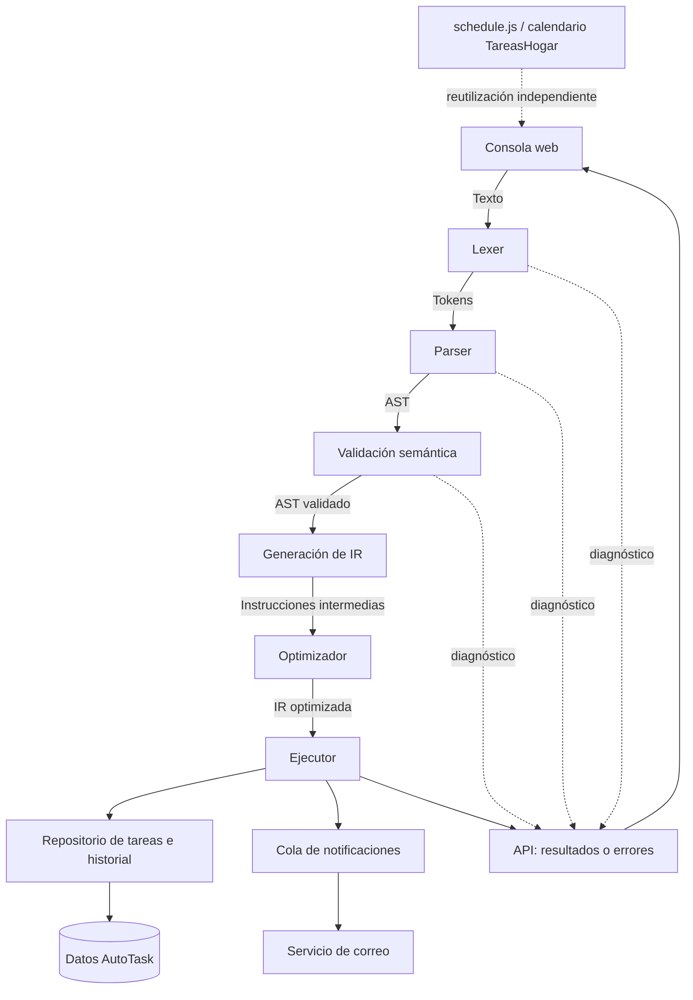

# AutoTask · Arquitectura y contratos iniciales

Borrador para revisión del equipo · [Issue #1](https://github.com/Angixs-zz/ProyectoAutomatas/issues/1). **No se ha registrado todavía la aprobación de Yareli ni del equipo.** Los ejemplos de sintaxis, el motor y la base de datos son propuestas, no funcionalidades implementadas.

## Alcance y base del calendario

AutoTask recibe instrucciones escritas en una consola web. El sistema valida el programa, puede ejecutarlo y muestra los resultados, las tareas y el historial de operaciones.

La base de `main` viene de TareasHogar. `index.html` y `styles.css` ofrecen una estructura reutilizable para la interfaz. `schedule.js` calcula las rotaciones por tarea, aplaza un turno si la persona ya tiene otra tarea ese fin de semana y exporta el calendario en formato `.ics`. `app.js` conecta esas reglas con la interfaz y guarda la configuración del calendario en `localStorage`.

La propuesta conserva el calendario y sus pruebas. Las reglas de rotación corresponden al calendario. La consola de AutoTask trabaja con tareas, estados y asignaciones persistidas por la API. Si el equipo quiere conectar ambos flujos, queda por acordar cómo se vincularía una tarea creada en la consola con una rotación.

## Flujo y contratos entre módulos



La API coordina el flujo y devuelve el resultado a la consola. Un fallo de análisis detiene el paso a ejecución. Validar un programa permite consultarlo y reportar errores sin guardar cambios ni enviar notificaciones.

La consola envía texto y modo (`validacion` o `ejecucion`) a la API; la API aporta la identidad del usuario, no el texto. El correo no debe salir durante el análisis ni antes de confirmar cambios en datos. Un fallo en una condición evita ejecutar su acción; la semántica de transacciones por programa y los reintentos de correo se acuerdan con Edwin y Diego antes de implementar el ejecutor.

| Módulo | Entrada | Salida |
| --- | --- | --- |
| Lexer | Texto del programa | Tokens con tipo, valor y ubicación, o diagnóstico léxico. |
| Parser | Tokens | Árbol sintáctico (AST) de comandos, argumentos y condiciones, o diagnóstico sintáctico. |
| Semántica | AST y acceso de lectura a tareas y usuarios | AST validado, o diagnóstico sobre referencias, tipos, estados u operaciones. |
| Generador de IR | AST validado | Operaciones tipadas y control de flujo en una representación intermedia (IR). |
| Optimizador | IR | IR equivalente que conserva resultados, orden de efectos e historial observable. |
| Ejecutor | IR y servicios de tareas y correo | Resultados por instrucción, efectos de las acciones ejecutadas y errores de ejecución. |

Contrato de datos para #2 (propuesta): el lexer devuelve tokens `{tipo, valor, inicio, fin}`; parser devuelve `{tipo: "Programa", instrucciones: [...], inicio, fin}` con ubicaciones propagadas en cada nodo; semántica recibe AST, usuario y acceso **de lectura** a tareas/usuarios y devuelve AST con referencias resueltas y tabla de símbolos; IR recibe nodos validados y produce instrucciones `{operacion, argumentos, ubicacion}` sin efectos. Ubicaciones usan línea/columna desde 1, con fin exclusivo. Los IDs internos de tarea y usuario no son nombres visibles: si un nombre coincide con varias entidades, reportar ambigüedad, no escoger una arbitrariamente. Si una instrucción crea y otra usa la misma tarea en un programa, el equipo debe definir referencias simbólicas o limitar la primera versión a una instrucción por envío.

### Catálogo propuesto

| Operación | Datos mínimos |
| --- | --- |
| Crear tarea | Título; identificador explícito o generado por el servicio (pendiente de acuerdo). |
| Asignar tarea | Identificadores de tarea y usuario. |
| Cambiar estado | Identificador de tarea y nuevo estado. |
| Consultar o listar | Identificador para consultar una tarea. Listar devuelve la colección. |
| Notificar | Identificador de usuario y mensaje; pendiente decidir si se exige una tarea asociada. |
| Solicitar correo de prueba | Destinatario y mensaje. El envío de prueba se verifica con Mailpit. |
| `SI … ENTONCES` | Condición y acción que se ejecuta cuando la condición es verdadera. |

Ejemplos **provisionales**, sujetos a la gramática de Yareli: `CREAR TAREA "Preparar informe"`, `ASIGNAR "Preparar informe" A "Yareli"`, `CAMBIAR ESTADO "Preparar informe" A "terminada"`, `CONSULTAR "Preparar informe"`, `LISTAR TAREAS`, `NOTIFICAR "Yareli" "Preparar informe"`, `SI "Preparar informe" ESTA PENDIENTE ENTONCES NOTIFICAR "Yareli" "Preparar informe"`. No fijan aún mayúsculas, acentos, formato de fechas, separadores, precedencia ni escapes de cadenas. El correo de prueba es distinto de una notificación real y no debe interpretarse como entrega confirmada. Pendiente acordar estados/transiciones, condiciones admitidas, destinatario y contenido de notificaciones, y si crear requiere ID explícito o lo genera el servicio.

Yareli define las palabras clave, las reglas de escritura y la gramática EBNF en el [issue #2](https://github.com/Angixs-zz/ProyectoAutomatas/issues/2). El catálogo de esta tabla propone el significado de cada operación.

### Formato de respuesta propuesto

Respuesta de validación correcta. Una ejecución correcta llenaría `resultados` en orden de instrucción.

```json
{
  "ok": true,
  "modo": "validacion",
  "resultados": [],
  "diagnosticos": []
}
```

Ejemplo provisional de ejecución correcta; `en_cola` indica solicitud aceptada, **no entrega del correo**:

```json
{
  "ok": true,
  "modo": "ejecucion",
  "resultados": [
    { "operacion": "crear", "tareaId": "task_123", "estado": "pendiente" },
    { "operacion": "notificar", "estado": "en_cola" }
  ],
  "diagnosticos": []
}
```

Respuesta de validación con un argumento faltante. La línea y la columna empiezan en 1. Se usa `null` cuando el error carece de ubicación en el texto.

```json
{
  "ok": false,
  "modo": "validacion",
  "resultados": [],
  "diagnosticos": [
    {
      "etapa": "sintactica",
      "codigo": "ARGUMENTO_FALTANTE",
      "mensaje": "Se esperaba un identificador de tarea.",
      "linea": 2,
      "columna": 10
    }
  ]
}
```

Ejemplo de referencia semántica inválida (no se ejecuta el programa):

```json
{
  "ok": false,
  "modo": "ejecucion",
  "resultados": [],
  "diagnosticos": [
    { "etapa": "semantica", "codigo": "TAREA_INEXISTENTE", "mensaje": "No existe la tarea «Informe».", "linea": 1, "columna": 10 }
  ]
}
```

El diagnóstico identifica su etapa con `lexica`, `sintactica`, `semantica` o `ejecucion`. Diego y Melody acuerdan los endpoints, estados HTTP y campos de los resultados en el [issue #6](https://github.com/Angixs-zz/ProyectoAutomatas/issues/6).

Contrato de errores para revisar con Yareli: `ok=false` implica `resultados=[]` en validación; cada diagnóstico contiene `etapa`, `codigo` estable, `mensaje` legible y `linea`/`columna` (ambos `null` si no hay ubicación). Ejemplos de códigos propuestos: `CARACTER_INVALIDO` y `CADENA_SIN_CERRAR` (`lexica`), `TOKEN_INESPERADO` y `ARGUMENTO_FALTANTE` (`sintactica`), `TAREA_INEXISTENTE`, `TAREA_AMBIGUA`, `USUARIO_INEXISTENTE` y `ESTADO_INVALIDO` (`semantica`), `CONFLICTO` y `ERROR_PERSISTENCIA` (`ejecucion`). Un error inesperado no revela stack ni secretos en el mensaje. El parser señala el token inesperado o la posición final cuando falte un argumento; definir con Yareli si se devuelve el primer error o una lista recuperada y cómo señalar el fin de entrada. El HTTP y los campos adicionales (p. ej. ID de petición o rango completo de ubicación) quedan para #6; evitar que la consola deduzca la causa leyendo el texto de `mensaje`.

## Tecnología y persistencia propuestas

- Mantener HTML, CSS y JavaScript para adaptar la interfaz existente. Usar Node.js para el motor y la API.
- Usar PostgreSQL con migraciones y datos de ejemplo para usuarios, tareas, asignaciones, estados, notificaciones e historial. Mantener `localStorage` para la configuración local del calendario.
- En la base actual, `schedule.js` contiene personas, tareas y fecha de inicio del calendario; `app.js` guarda tareas personalizadas en `localStorage['autotask-tareas']`, selección en `localStorage['autotask-combinacion-v1']` y tema en `localStorage['autotask-tema']`. Es almacenamiento por navegador, no compartido. En la propuesta, PostgreSQL sería la fuente de verdad del tablero, historial y solicitudes/estado de notificaciones; no guardar credenciales SMTP allí ni en `localStorage`. La vinculación o migración desde el calendario requiere decisión explícita.
- Preparar Docker Compose para la aplicación, PostgreSQL y Mailpit. El servicio de correo de prueba entra en el alcance del [issue #14](https://github.com/Angixs-zz/ProyectoAutomatas/issues/14) y el empaquetado en el [issue #17](https://github.com/Angixs-zz/ProyectoAutomatas/issues/17).

## Arranque y revisión

La base requiere Node.js 22 o superior y Python 3. El repositorio se puede clonar con `git clone https://github.com/Angixs-zz/ProyectoAutomatas.git`. Desde la carpeta `ProyectoAutomatas`, usar estos comandos para iniciar la rama de arquitectura.

```sh
git switch main
git pull --ff-only origin main
git switch -c feature/lt-1
npm test
npm start
```

Abrir `http://localhost:8080`. El calendario y sus pruebas funcionan sin instalar paquetes adicionales. El arranque y las 15 pruebas base se verificaron sobre `e99b88f`.

| Revisar con | Acuerdo pendiente |
| --- | --- |
| Yareli | Catálogo, sintaxis, ubicaciones y nodos que entrega el parser. |
| Angel | Forma del AST, tabla de símbolos y validación de programas que crean y luego usan una tarea. |
| Diego y Melody | Identificadores, estados, persistencia y ejemplos de respuesta para la consola. Melody puede maquetar con respuestas de ejemplo mientras se implementa la API. |
| Edwin y Diego | Efectos del ejecutor, comportamiento ante un fallo durante la ejecución y servicios de Docker. |

Cada responsable parte de `main`, abre su rama y enlaza el issue en su PR. El equipo revisa el PR antes de integrar y actualiza el avance en el [tablero de AutoTask](https://github.com/users/Angixs-zz/projects/4/views/1).
