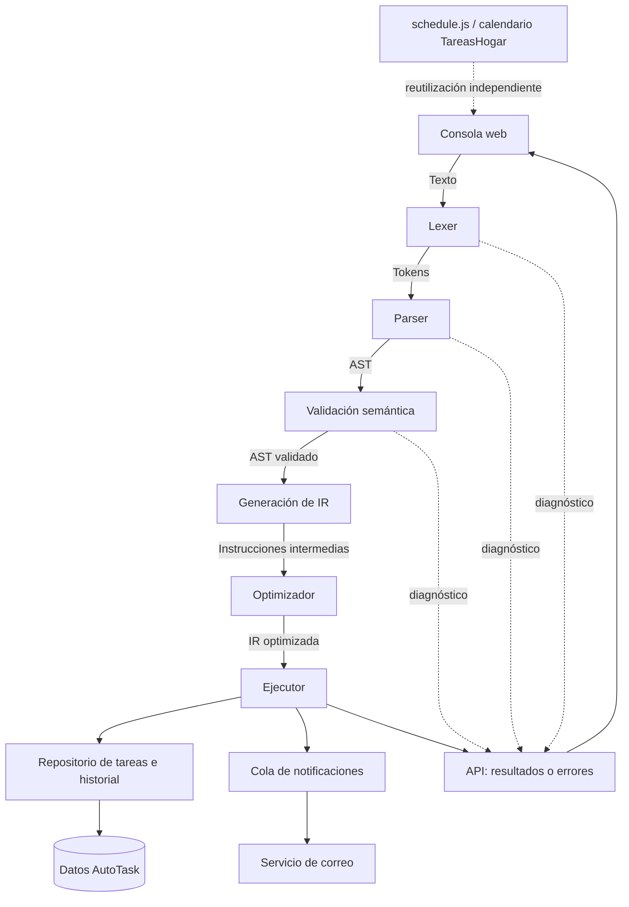
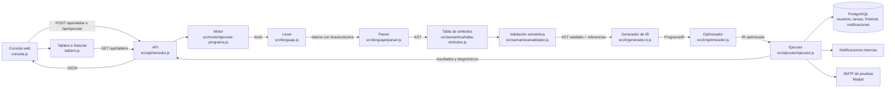

# AutoTask · Arquitectura y contratos iniciales

> **Estado del documento (2026-11-21).** Este texto conserva las **decisiones iniciales** de la Semana 1 y su redacción original. La implementación final ya está integrada en `main`; las diferencias entre la propuesta y lo entregado se documentan en la [sección 8](#8-implementación-final-verificada-2026-11-21). No se eliminó la documentación original para mantener trazabilidad entre el diseño y el resultado.

Borrador para revisión del equipo · [Issue #1](https://github.com/Angixs-zz/ProyectoAutomatas/issues/1). **No se ha registrado todavía la aprobación de Yareli ni del equipo.** Los ejemplos de sintaxis, el motor y la base de datos son propuestas, no funcionalidades implementadas.

## Alcance y base del calendario

AutoTask recibe instrucciones escritas en una consola web. El sistema valida el programa, puede ejecutarlo y muestra los resultados, las tareas y el historial de operaciones.

La base de `main` viene de TareasHogar. `index.html` y `styles.css` ofrecen una estructura reutilizable para la interfaz. `schedule.js` calcula las rotaciones por tarea, aplaza un turno si la persona ya tiene otra tarea ese fin de semana y exporta el calendario en formato `.ics`. `app.js` conecta esas reglas con la interfaz y guarda la configuración del calendario en `localStorage`.

La propuesta conserva el calendario y sus pruebas. Las reglas de rotación corresponden al calendario. La consola de AutoTask trabaja con tareas, estados y asignaciones persistidas por la API. Si el equipo quiere conectar ambos flujos, queda por acordar cómo se vincularía una tarea creada en la consola con una rotación.

## Flujo y contratos entre módulos



La API coordina el flujo y devuelve el resultado a la consola. Un fallo de análisis detiene el paso a ejecución. Validar un programa permite consultarlo y reportar errores sin guardar cambios ni enviar notificaciones.

La consola envía texto y modo (`validacion` o `ejecucion`) a la API; la API aporta la identidad del usuario, no el texto. El correo no debe salir durante el análisis ni antes de confirmar cambios en datos. Un fallo en una condición evita ejecutar su acción; la semántica de transacciones por programa y los reintentos de correo se acuerdan con Edwin y Diego antes de implementar el ejecutor.

| Módulo | Entrada | Salida |
| --- | --- | --- |
| Lexer | Texto del programa | Tokens con tipo, valor y ubicación, o diagnóstico léxico. |
| Parser | Tokens | Árbol sintáctico (AST) de comandos, argumentos y condiciones, o diagnóstico sintáctico. |
| Semántica | AST y acceso de lectura a tareas y usuarios | AST validado, o diagnóstico sobre referencias, tipos, estados u operaciones. |
| Generador de IR | AST validado | Operaciones tipadas y control de flujo en una representación intermedia (IR). |
| Optimizador | IR | IR equivalente que conserva resultados, orden de efectos e historial observable. |
| Ejecutor | IR y servicios de tareas y correo | Resultados por instrucción, efectos de las acciones ejecutadas y errores de ejecución. |

Contrato de datos para #2 (propuesta): el lexer devuelve tokens `{tipo, valor, inicio, fin}`; parser devuelve `{tipo: "Programa", instrucciones: [...], inicio, fin}` con ubicaciones propagadas en cada nodo; semántica recibe AST, usuario y acceso **de lectura** a tareas/usuarios y devuelve AST con referencias resueltas y tabla de símbolos; IR recibe nodos validados y produce instrucciones `{operacion, argumentos, ubicacion}` sin efectos. Ubicaciones usan línea/columna desde 1, con fin exclusivo. Los IDs internos de tarea y usuario no son nombres visibles: si un nombre coincide con varias entidades, reportar ambigüedad, no escoger una arbitrariamente. Si una instrucción crea y otra usa la misma tarea en un programa, el equipo debe definir referencias simbólicas o limitar la primera versión a una instrucción por envío.

### Catálogo propuesto

| Operación | Datos mínimos |
| --- | --- |
| Crear tarea | Título; identificador explícito o generado por el servicio (pendiente de acuerdo). |
| Asignar tarea | Identificadores de tarea y usuario. |
| Cambiar estado | Identificador de tarea y nuevo estado. |
| Consultar o listar | Identificador para consultar una tarea. Listar devuelve la colección. |
| Notificar | Identificador de usuario y mensaje; pendiente decidir si se exige una tarea asociada. |
| Solicitar correo de prueba | Destinatario y mensaje. El envío de prueba se verifica con Mailpit. |
| `SI … ENTONCES` | Condición y acción que se ejecuta cuando la condición es verdadera. |

Ejemplos **provisionales**, sujetos a la gramática de Yareli: `CREAR TAREA "Preparar informe"`, `ASIGNAR "Preparar informe" A "Yareli"`, `CAMBIAR ESTADO "Preparar informe" A "terminada"`, `CONSULTAR "Preparar informe"`, `LISTAR TAREAS`, `NOTIFICAR "Yareli" "Preparar informe"`, `SI "Preparar informe" ESTA PENDIENTE ENTONCES NOTIFICAR "Yareli" "Preparar informe"`. No fijan aún mayúsculas, acentos, formato de fechas, separadores, precedencia ni escapes de cadenas. El correo de prueba es distinto de una notificación real y no debe interpretarse como entrega confirmada. Pendiente acordar estados/transiciones, condiciones admitidas, destinatario y contenido de notificaciones, y si crear requiere ID explícito o lo genera el servicio.

Yareli define las palabras clave, las reglas de escritura y la gramática EBNF en el [issue #2](https://github.com/Angixs-zz/ProyectoAutomatas/issues/2). El catálogo de esta tabla propone el significado de cada operación.

### Formato de respuesta propuesto

Respuesta de validación correcta. Una ejecución correcta llenaría `resultados` en orden de instrucción.

```json
{
  "ok": true,
  "modo": "validacion",
  "resultados": [],
  "diagnosticos": []
}
```

Ejemplo provisional de ejecución correcta; `en_cola` indica solicitud aceptada, **no entrega del correo**:

```json
{
  "ok": true,
  "modo": "ejecucion",
  "resultados": [
    { "operacion": "crear", "tareaId": "task_123", "estado": "pendiente" },
    { "operacion": "notificar", "estado": "en_cola" }
  ],
  "diagnosticos": []
}
```

Respuesta de validación con un argumento faltante. La línea y la columna empiezan en 1. Se usa `null` cuando el error carece de ubicación en el texto.

```json
{
  "ok": false,
  "modo": "validacion",
  "resultados": [],
  "diagnosticos": [
    {
      "etapa": "sintactica",
      "codigo": "ARGUMENTO_FALTANTE",
      "mensaje": "Se esperaba un identificador de tarea.",
      "linea": 2,
      "columna": 10
    }
  ]
}
```

Ejemplo de referencia semántica inválida (no se ejecuta el programa):

```json
{
  "ok": false,
  "modo": "ejecucion",
  "resultados": [],
  "diagnosticos": [
    { "etapa": "semantica", "codigo": "TAREA_INEXISTENTE", "mensaje": "No existe la tarea «Informe».", "linea": 1, "columna": 10 }
  ]
}
```

El diagnóstico identifica su etapa con `lexica`, `sintactica`, `semantica` o `ejecucion`. Diego y Melody acuerdan los endpoints, estados HTTP y campos de los resultados en el [issue #6](https://github.com/Angixs-zz/ProyectoAutomatas/issues/6).

Contrato de errores para revisar con Yareli: `ok=false` implica `resultados=[]` en validación; cada diagnóstico contiene `etapa`, `codigo` estable, `mensaje` legible y `linea`/`columna` (ambos `null` si no hay ubicación). Ejemplos de códigos propuestos: `CARACTER_INVALIDO` y `CADENA_SIN_CERRAR` (`lexica`), `TOKEN_INESPERADO` y `ARGUMENTO_FALTANTE` (`sintactica`), `TAREA_INEXISTENTE`, `TAREA_AMBIGUA`, `USUARIO_INEXISTENTE` y `ESTADO_INVALIDO` (`semantica`), `CONFLICTO` y `ERROR_PERSISTENCIA` (`ejecucion`). Un error inesperado no revela stack ni secretos en el mensaje. El parser señala el token inesperado o la posición final cuando falte un argumento; definir con Yareli si se devuelve el primer error o una lista recuperada y cómo señalar el fin de entrada. El HTTP y los campos adicionales (p. ej. ID de petición o rango completo de ubicación) quedan para #6; evitar que la consola deduzca la causa leyendo el texto de `mensaje`.

## Tecnología y persistencia propuestas

- Mantener HTML, CSS y JavaScript para adaptar la interfaz existente. Usar Node.js para el motor y la API.
- Usar PostgreSQL con migraciones y datos de ejemplo para usuarios, tareas, asignaciones, estados, notificaciones e historial. Mantener `localStorage` para la configuración local del calendario.
- En la base actual, `schedule.js` contiene personas, tareas y fecha de inicio del calendario; `app.js` guarda tareas personalizadas en `localStorage['autotask-tareas']`, selección en `localStorage['autotask-combinacion-v1']` y tema en `localStorage['autotask-tema']`. Es almacenamiento por navegador, no compartido. En la propuesta, PostgreSQL sería la fuente de verdad del tablero, historial y solicitudes/estado de notificaciones; no guardar credenciales SMTP allí ni en `localStorage`. La vinculación o migración desde el calendario requiere decisión explícita.
- Preparar Docker Compose para la aplicación, PostgreSQL y Mailpit. El servicio de correo de prueba entra en el alcance del [issue #14](https://github.com/Angixs-zz/ProyectoAutomatas/issues/14) y el empaquetado en el [issue #17](https://github.com/Angixs-zz/ProyectoAutomatas/issues/17).

## Arranque y revisión

La base requiere Node.js 22 o superior y Python 3. El repositorio se puede clonar con `git clone https://github.com/Angixs-zz/ProyectoAutomatas.git`. Desde la carpeta `ProyectoAutomatas`, usar estos comandos para traer la rama de arquitectura ya publicada.

```sh
git switch main
git pull --ff-only origin main
git switch feature/lt-1
npm test
npm start
```

Si la rama no existe en tu copia local, usa `git switch -c feature/lt-1 origin/feature/lt-1` en lugar de `git switch feature/lt-1`.

Abrir `http://localhost:8080`. El calendario y sus pruebas funcionan sin instalar paquetes adicionales. El arranque y las 15 pruebas base se verificaron sobre `e99b88f`.

| Revisar con | Acuerdo pendiente |
| --- | --- |
| Yareli | Catálogo, sintaxis, ubicaciones y nodos que entrega el parser. |
| Angel | Forma del AST, tabla de símbolos y validación de programas que crean y luego usan una tarea. |
| Diego y Melody | Identificadores, estados, persistencia y ejemplos de respuesta para la consola. Melody puede maquetar con respuestas de ejemplo mientras se implementa la API. |
| Edwin y Diego | Efectos del ejecutor, comportamiento ante un fallo durante la ejecución y servicios de Docker. |

Cada responsable parte de `main`, abre su rama y enlaza el issue en su PR. El equipo revisa el PR antes de integrar y actualiza el avance en el [tablero de AutoTask](https://github.com/users/Angixs-zz/projects/4/views/1).

---

## 8. Implementación final verificada (2026-11-21)

Esta sección no reemplaza las decisiones iniciales: las contrasta con el código que quedó integrado en `main`. La verificación se hizo sobre el commit de `main` posterior a los PR #36 y #37.

### 8.1 Flujo real del compilador y del ejecutor

El flujo implementado coincide con el trazado inicial y añade el contrato HTTP:



La API ejecuta el pipeline en dos modos:

- `validacion`: lexer → parser → tabla de símbolos → semántica → IR → optimizador. No llama al ejecutor.
- `ejecucion`: el mismo pipeline y después `ejecutarIR`.

### 8.2 Mapa de módulos implementados

| Módulo | Archivo principal | Entrada | Salida | Pruebas |
| --- | --- | --- | --- | --- |
| Lexer | `src/lenguaje.js` | Texto del programa | Tokens `{tipo, valor, inicio, fin}` y diagnósticos léxicos | `tests/lexer.test.js` |
| Parser / AST | `src/lenguaje/parser.js` | Tokens | AST `Programa` con instrucciones y ubicaciones, o diagnósticos sintácticos | `tests/parser.test.js` |
| Tabla de símbolos | `src/semantica/tabla-simbolos.js` | Repositorio de lectura | Símbolos de tareas y usuarios; errores de inexistencia/ambigüedad | `tests/tabla-simbolos.test.js` |
| Validación semántica | `src/semantica/validador.js` | AST + tabla de símbolos | AST con referencias resueltas o diagnósticos semánticos | `tests/validador.test.js` |
| Generador de IR | `src/ir/generador-ir.js` | AST validado | `ProgramaIR` de solo datos | `tests/generador-ir.test.js` |
| Optimizador | `src/ir/optimizador.js` | `ProgramaIR` | `ProgramaIR` equivalente con metadatos de optimización | `tests/optimizador.test.js` |
| Ejecutor | `src/ejecutor/ejecutor.js` | IR + servicios | Resultados, errores de ejecución y fallos parciales | `tests/ejecutor.test.js` |
| Orquestador | `src/motor/ejecutar-programa.js` | Texto + modo | Respuesta completa del programa | `tests/integracion.test.js` |
| API HTTP | `src/api/servidor.js` | Peticiones HTTP | JSON de salud, tablero, validación y ejecución | `tests/servidor.test.js` |
| Persistencia PostgreSQL | `src/persistencia/repositorio-postgres.js` | Operaciones del ejecutor | Tareas, historial y notificaciones persistidas | `tests/repositorio-postgres.test.js` |
| Correo SMTP | `src/ejecutor/correo-smtp.js` | Destinatario y mensaje | Solicitud aceptada por Mailpit | `tests/correo-smtp.test.js` |
| Consola web | `consola.js` | Texto de la persona usuaria | Llamadas a `/api/validar` y `/api/ejecutar`; estados de carga/error | `tests/consola-ejemplos.test.js` |
| Tablero e historial | `tablero.js` | `GET /api/tablero` | Columnas por estado e historial filtrable | `tests/tablero-ejemplos.test.js` |
| Calendario heredado | `app.js`, `schedule.js` | Configuración local | Rotaciones y exportación `.ics` | `tests/schedule.test.js` |
| Suite E2E | `e2e/autotask.e2e.mjs` | Docker Compose | Verificación app + PostgreSQL + Mailpit | `npm run test:e2e` |

### 8.3 Decisiones iniciales frente a la implementación final

| Tema | Decisión inicial (Semana 1) | Implementación final |
| --- | --- | --- |
| Stack | Se propuso HTML/CSS/JS para la interfaz y Node.js para el motor/API; se dejó abierto el framework. | Node.js 22, HTML/CSS/JavaScript sin framework, PostgreSQL 16 y Docker Compose. No se usó React ni FastAPI. |
| Sintaxis | Ejemplos provisionales con distintas formas (`ASIGNAR "t" A "u"`, estados en minúsculas). | Gramática EBNF cerrada: `CREAR TAREA "t"`, `ASIGNAR TAREA "t" A "u"`, estados en mayúsculas. Ver `docs/gram_tica_formal_autotask.md`. |
| Identificación | Se discutió usar IDs explícitos o títulos. | Las tareas se referencian por **título exacto** entre comillas; los usuarios por **nombre exacto**. Los IDs (`task_N`, `user_N`) son internos. |
| API | Se propuso `POST /api/programas` con `{texto, modo}`. | Se implementaron rutas separadas: `POST /api/validar` y `POST /api/ejecutar`, con `{programa}` (o alias `texto`), más `GET /api/salud` y `GET /api/tablero`. Ver `docs/contrato-api.md`. |
| Errores de programa | Se discutió entre HTTP 200/400/422. | Los errores léxicos, sintácticos, semánticos y de ejecución devuelven **HTTP 200** con `ok: false` y `diagnosticos`. Los 400/405/500 se reservan para la petición o el servidor. |
| Resultados | Formato provisional con `task_123` y `en_cola`. | Formato estable por operación, con `linea`, `operacion`, IDs, títulos y estados. `en_cola` significa aceptado, no entregado. Los detalles están en `docs/contrato-ir.md` y `docs/contrato-api.md`. |
| Estados | Pendiente de acuerdo. | `PENDIENTE`, `EN_PROGRESO`, `COMPLETADA`, `CANCELADA`; transiciones en `src/semantica/validador.js`. `COMPLETADA` y `CANCELADA` son finales. |
| Persistencia | PostgreSQL como fuente de verdad; `localStorage` solo para el calendario. | Se cumple: PostgreSQL guarda usuarios, tareas, historial y notificaciones. El calendario conserva su configuración en `localStorage`. Sin PostgreSQL, la API usa memoria para pruebas. |
| Transacciones | Se acordó que un fallo no dejara efectos parciales. | Las operaciones de tareas se ejecutan en una transacción. Notificaciones y correos se despachan después del `COMMIT`; un fallo posterior se informa con `partial: true` y estados `incierto`/`no_procesado`. |
| Condicional | `SI ... ENTONCES` con una acción simple. | Implementado sin anidamiento. Se traduce a `EVALUAR_ESTADO`, `SALTAR_SI_FALSO`, acción y `ETIQUETA`. |
| Repetición | Opcional según el PDF. | **No implementada**; queda como limitación. |
| Docker | `docker compose up --build` con frontend, backend, PostgreSQL y Mailpit. | `app` sirve frontend y API en un solo servicio, más `postgres` y `mailpit`. No hay servicio separado de frontend. |
| Correo | SMTP de pruebas con Mailpit. | Cliente SMTP nativo en `src/ejecutor/correo-smtp.js`; los mensajes se verifican en Mailpit (`http://localhost:8025`). |
| Tablero | Panel de dispositivos simulado o tablero de tareas. | Al ser la opción AutoTask, el panel visual es el **tablero de tareas** por estado, con historial. |

### 8.4 Persistencia, SMTP y API en la entrega final

- **PostgreSQL:** `db/init/001_esquema.sql` crea `usuarios`, `tareas`, `historial_tareas` y `notificaciones`; `002_datos_demo.sql` carga usuarios y tareas de ejemplo; `003_alinear_historial_notificaciones.sql` alinea estados y columnas con el ejecutor y el tablero. El detalle está en `docs/persistencia.md`.
- **Repositorio:** `crearRepositorioPostgres(pool)` implementa lectura, escritura transaccional, historial y notificaciones. Cumple el contrato que esperan la semántica y el ejecutor.
- **SMTP:** Mailpit recibe los correos en el puerto SMTP interno `1025`; la interfaz de inspección está en `8025`. El envío no requiere cuentas reales.
- **API:** `src/api/servidor.js` expone `/api/salud`, `/api/tablero`, `/api/validar` y `/api/ejecutar`, y sirve los archivos estáticos de la consola, el tablero y el calendario.
- **Frontend:** `index.html` integra la consola, el tablero y el calendario heredado. `consola.js` y `tablero.js` consumen la API; `app.js` y `schedule.js` mantienen el calendario de TareasHogar.

### 8.5 Arranque y flujo de trabajo del equipo

El arranque vigente no requiere cambiar a `feature/lt-1`:

```sh
git switch main
git pull --ff-only origin main
npm test
npm start                 # API + frontend en http://localhost:8080
# o, con PostgreSQL y Mailpit:
cp .env.example .env
docker compose up --build
```

Flujo de trabajo conservado:

1. Cada responsable parte de `main` y crea una rama `feature/<área>` o `fix/<tema>`.
2. El PR enlaza su issue, describe el cambio, indica cómo probarlo y conserva la autoría de los commits.
3. El equipo revisa el PR antes de fusionarlo; no se usa `git push --force` ni se borran ramas con trabajo.
4. El avance se refleja en el [tablero de AutoTask](https://github.com/users/Angixs-zz/projects/4/views/1).
5. `main` se mantiene ejecutable: `npm test` no requiere Docker y `npm run test:e2e` valida la integración real.

### 8.6 Evidencia de cumplimiento del issue #1

| Criterio | Evidencia |
| --- | --- |
| Diagrama y mapa de módulos con entradas y salidas | Diagrama de 8.1 y tabla de 8.2; mapa original conservado en la sección 2. |
| Acuerdo escrito sobre catálogo, alcance, resultados, errores, tecnologías y persistencia | Secciones 8.3–8.4, `docs/gram_tica_formal_autotask.md`, `docs/contrato-ir.md`, `docs/contrato-api.md` y `docs/persistencia.md`. |
| El equipo puede localizar la base, levantarla y seguir ramas → PR → revisión → Kanban | Sección 8.5, `README.md`, `docker-compose.yml`, `.env.example` y el tablero de GitHub Projects. |
| Verificación ejecutable | `npm test`: 120/120 pruebas; `npm run test:e2e`: 5/5 pruebas contra Docker Compose. |
