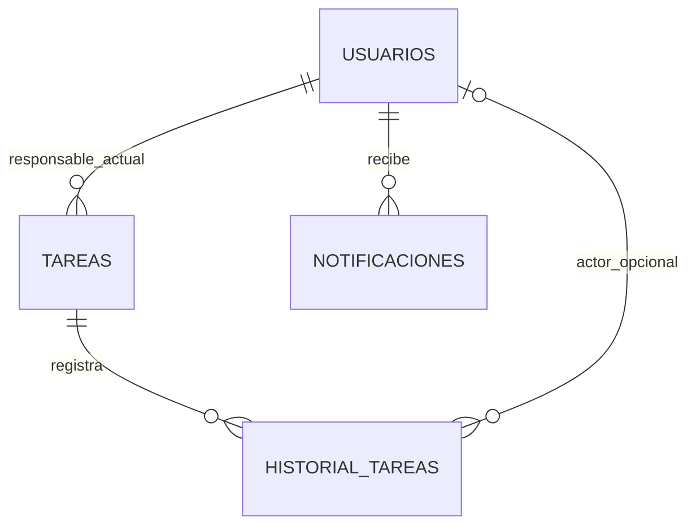

# Persistencia de AutoTask · BE-1 (#5)

## Modelo inicial

- `usuarios`: identificador compatible con `user_N`, nombre y correo opcional.
- `tareas`: identificador compatible con `task_N`, título, fecha opcional, estado actual y `responsable_id` opcional.
- `historial_tareas`: eventos append-only de creación, asignación/reasignación y cambio de estado, con valores anterior/nuevo en JSONB.
- `notificaciones`: mensajes internos persistidos con estado `en_cola`, `enviado` o `error`. El envío SMTP corresponde a otro issue.

El responsable actual se guarda en `tareas.responsable_id` para que el repositorio entregue directamente `responsableId`, como espera la semántica y el ejecutor. Las reasignaciones pasadas se conservan en `historial_tareas`; no hay dos fuentes de verdad para la asignación actual. Los cuatro estados y sus transiciones permanecen definidos por `src/semantica/validador.js`.

## Contratos del repositorio

`crearRepositorioPostgres(pool)` implementa `listarTareas()` y `listarUsuarios()` para `crearTablaSimbolos`, además de las operaciones usadas por el ejecutor: `crearTarea`, `asignarTarea`, `cambiarEstado`, `consultarTarea`, `listarTareas` y `ejecutarEnTransaccion(callback)`. Devuelve campos camelCase (`responsableId`, `fecha`) aunque PostgreSQL use `responsable_id`.

Los writes directos y sus eventos de historial se confirman juntos. `ejecutarEnTransaccion` permite que el ejecutor agrupe varias instrucciones en una única transacción y haga rollback si falla. Las consultas usan parámetros `$1`, `$2`, etc. El adaptador de notificaciones expone `registrarNotificacion` por separado; no envía correo.

## Inicialización local

`db/init/001_esquema.sql` crea las tablas, restricciones e índices. `002_datos_demo.sql` inserta los mismos usuarios y tareas que los mocks actuales y puede ejecutarse más de una vez sin duplicarlos. Docker ejecuta estos scripts solo al inicializar un volumen PostgreSQL vacío.

Para ejecutar el conjunto de pruebas: `npm test`. La suite unitaria no requiere un servidor PostgreSQL; para probar la migración de extremo a extremo, levantar PostgreSQL con `docker compose up -d postgres` y conectar con `DATABASE_URL`.
